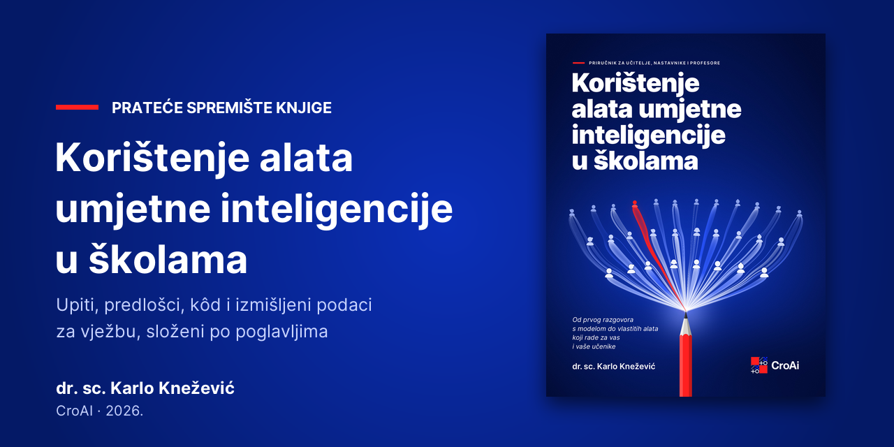
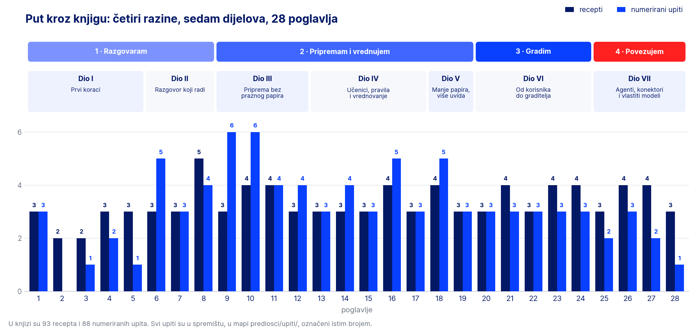
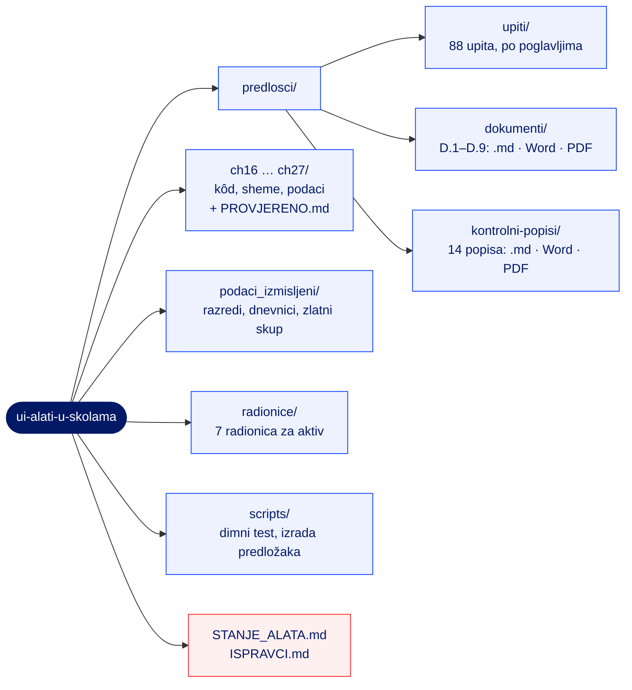
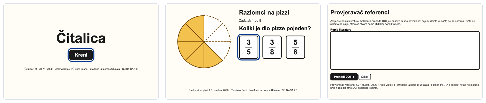
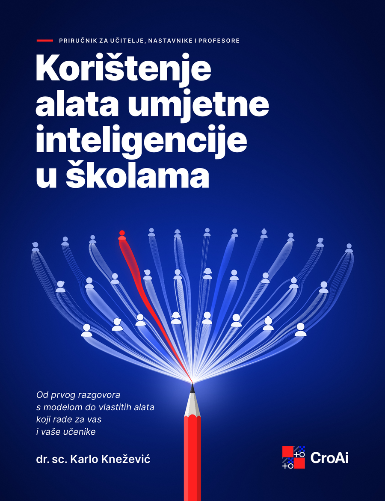

<div align="center">



# Korištenje alata umjetne inteligencije u školama

### Prateće spremište knjige: upiti, predlošci, kôd i izmišljeni podaci za vježbu

**dr. sc. Karlo Knežević** · Hrvatska udruga za umjetnu inteligenciju (CroAI) · Zagreb, 2026.

[](#kako-citirati)
[](https://github.com/KarloKnezevic/ui-alati-u-skolama/releases/latest)
[](STANJE_ALATA.md)
[](predlosci/upiti/README.md)
[](LICENSE)
[](LICENCA.md)

**[Preuzmite knjigu (PDF)](https://github.com/KarloKnezevic/ui-alati-u-skolama/releases/latest/download/Koristenje_UI_alata_u_skolama.pdf)** ·
[Stanje alata](STANJE_ALATA.md) ·
[Ispravci](ISPRAVCI.md) ·
[Prijavite pogrešku](https://github.com/KarloKnezevic/ui-alati-u-skolama/issues/new/choose)

</div>

---

> *Model zna mnogo odgovora. Samo učitelj zna koji treba baš ovom učeniku.*

Knjiga *Korištenje alata umjetne inteligencije u školama* napisana je za
učitelje, nastavnike i profesore koji umjetnu inteligenciju žele rabiti
promišljeno, a ne zato što je u modi. Vodi od prvog razgovora s jezičnim
modelom, preko pripreme nastave, vrednovanja i administracije, do vlastitih
malih alata za razred. Primjeri dolaze iz hrvatskih škola, a predznanje iz
programiranja nije potrebno.

Ovo spremište stoji uz knjigu. U njemu je sve što se iz knjige prepisuje,
kopira ili pokreće: svih 88 numeriranih upita, predlošci školskih
dokumenata, kontrolni popisi za ispis, puni programski kôd iz dijelova VI i
VII, izmišljeni podaci za vježbu i materijali za sedam radionica za stručne
aktive. Spremište je ujedno i **mrežni dodatak knjige**: ovdje se održava
živa inačica dodatka A o stanju alata i popis ispravaka nakon objave.

## Gdje početi

| Želite… | Idite u | Treba vam |
|---|---|---|
| upit iz knjige, bez prepisivanja | [`predlosci/upiti/`](predlosci/upiti/README.md) | bilo koji opći asistent |
| školska pravila, izjavu o uporabi UI-ja, obavijest roditeljima | [`predlosci/dokumenti/`](predlosci/dokumenti/README.md) | Word ili uređivač teksta |
| kontrolni popis za ispis | [`predlosci/kontrolni-popisi/`](predlosci/kontrolni-popisi/README.md) | pisač |
| provjeriti je li alat još besplatan i što se promijenilo | [`STANJE_ALATA.md`](STANJE_ALATA.md) | ništa |
| voditi radionicu na stručnom aktivu | [`radionice/`](radionice/README.md) | projektor i 90 minuta |
| pokrenuti skriptu, aplikaciju ili poslužitelj iz knjige | mapa poglavlja, npr. [`ch23/`](ch23/README.md) | upute iz dodatka E |

## Put kroz knjigu

Knjiga ima 28 poglavlja u sedam dijelova i vodi kroz četiri razine: od
razgovora s modelom, preko pripreme i vrednovanja, do gradnje i povezivanja
vlastitih alata. Grafikon pokazuje koliko recepata i numeriranih upita nosi
svako poglavlje.

<p align="center">
  
</p>

| Dio | Naslov | Poglavlja | Razina |
|---|---|---|---|
| I | Prvi koraci | 1–5 | Razgovaram |
| II | Razgovor koji radi | 6–8 | Razgovaram |
| III | Priprema bez praznog papira | 9–12 | Pripremam i vrednujem |
| IV | Učenici, pravila i vrednovanje | 13–17 | Pripremam i vrednujem |
| V | Manje papira, više uvida | 18–19 | Pripremam i vrednujem |
| VI | Od korisnika do graditelja | 20–24 | Gradim |
| VII | Agenti, konektori i vlastiti modeli | 25–28 | Povezujem |

## Što je u spremištu



Svaka mapa poglavlja ima `README.md` (što je u mapi i kako se pokreće) i
`PROVJERENO.md` (kada je kôd zadnji put pokrenut, s kojim inačicama i kojim
modelom). Ako je datum star, prije uporabe pogledajte
[`STANJE_ALATA.md`](STANJE_ALATA.md) i [`ISPRAVCI.md`](ISPRAVCI.md).

### Kôd po poglavljima

| Mapa | Poglavlje | Što je unutra |
|---|---|---|
| [`ch16/`](ch16/README.md) | 16 · Provjere, kvizovi i rubrike | kviz kao podatak: JSON i GIFT za uvoz u Moodle/Loomen |
| [`ch19/`](ch19/README.md) | 19 · Što nam govore rezultati | izmišljeni rezultati razreda, formule za tablicu, analiza u Pythonu i bilježnici |
| [`ch20/`](ch20/README.md) | 20 · Vlastiti asistent | upute asistenta i vještina „listić u tri staze” |
| [`ch21/`](ch21/README.md) | 21 · Tablica koja radi sama | Apps Script: kviz iz tablice, poruke, brojač, namjerno pokvarena inačica |
| [`ch22/`](ch22/README.md) | 22 · Kôd bez straha | primjeri za čitanje i popravljanje, kostur skripte, kviz u listić |
| [`ch23/`](ch23/README.md) | 23 · API i strukturirani izlaz | `pitajModel`, JSON-sheme, trideset listića, povratna informacija, zlatni skup, primjeri za `curl` |
| [`ch24/`](ch24/README.md) | 24 · Napravite si aplikaciju | Čitalica, Razlomci na pizzi, Provjeravač referenci |
| [`ch25/`](ch25/README.md) | 25 · Agenti i tijekovi rada | tjedni okidač |
| [`ch26/`](ch26/README.md) | 26 · Konektori, pretraživanje po značenju i MCP | MCP poslužitelj nad knjižnicom listića, pretraživanje po značenju |
| [`ch27/`](ch27/README.md) | 27 · Model na vlastitom računalu | jedan poziv za oblak i Ollamu, obrazac testa hrvatskog |

### Aplikacije iz poglavlja 24: isprobajte u pregledniku

Sve tri aplikacije stanu u jednu HTML datoteku, rade bez interneta i bez
prijave i ništa ne spremaju. Otvorite ih izravno:
**[Čitalica](https://karloknezevic.github.io/ui-alati-u-skolama/ch24/citalica.html)** ·
**[Razlomci na pizzi](https://karloknezevic.github.io/ui-alati-u-skolama/ch24/razlomci_na_pizzi.html)** ·
**[Provjeravač referenci](https://karloknezevic.github.io/ui-alati-u-skolama/ch24/provjeravac_referenci.html)**

<p align="center">
  
</p>

## Tri pravila koja vrijede za sve ovdje

1. **Nikakvi podaci o učenicima.** Svi podaci u spremištu su izmišljeni:
   imena, šifre, rezultati, bilješke i adrese (`vasa.adresa@example.com`).
   Kad primjer prilagođavate, stvarne podatke učenika ne unosite u javne
   alate; vodite se CARNET-ovim Smjernicama i uputama službenika za
   zaštitu podataka svoje škole.
2. **Nijedan ključ u kôdu.** Gdje skripta treba ključ API-ja, u kôdu stoji
   samo naziv svojstva ili varijable okruženja. Kako se ključ sprema, piše
   u dodatku E knjige.
3. **Prvi nacrt uređujete vi.** Upiti i predlošci su polazište. Ono što
   dođe u razred provjerava nastavnik.

## Pokretanje primjera

Za upite i predloške ne treba ništa osim preglednika. Za kôd iz dijelova
VI i VII postupak je u dodatku E knjige. Ukratko, za Python primjere:

```bash
git clone https://github.com/KarloKnezevic/ui-alati-u-skolama.git
cd ui-alati-u-skolama/ch19
python3 -m venv .venv && source .venv/bin/activate
pip install -r requirements.txt
python analiza_kviza.py
```

Apps Script primjeri (`.gs`) kopiraju se u uređivač skripti Google
tablice (*Proširenja → Apps Script*). Inačice paketa su fiksirane u
`requirements.txt`, pa primjer koji je radio danas radi i sutra.

**Dimni test** pokreće svaki primjer redom i javlja što je prošlo:

```bash
python3 scripts/provjeri_primjere.py                 # s probnim pozivom, ako je postavljen GEMINI_API_KEY
python3 scripts/provjeri_primjere.py --bez-poziva    # bez ključa i bez mreže
```

Pokrećemo ga prije svakog izdanja i jednom u polugodištu, a datume
upisujemo u `PROVJERENO.md`.

## Živa inačica i ispravci

Alati se mijenjaju brže nego što izlaze knjige. Zato knjiga brzo
promjenjive činjenice (modele, planove, cijene, putanje izbornika) skuplja
u dodatku A, a ovdje ih održavamo:

- **[STANJE_ALATA.md](STANJE_ALATA.md)**: živa inačica dodatka A, s datumom i
  oznakom pouzdanosti uz svaku stavku;
- **[ISPRAVCI.md](ISPRAVCI.md)**: pogreške pronađene nakon objave i promjene
  u sučeljima koje mijenjaju recept, s datumom.

## Prijava pogreške

Ako pronađete pogrešku u knjizi ili primjer koji više ne radi, javite:

- na GitHubu: **[nova prijava](https://github.com/KarloKnezevic/ui-alati-u-skolama/issues/new/choose)**;
- e-poštom: **[croai@croai.org](mailto:croai@croai.org)**.

Navedite stranicu ili mapu, što ste očekivali, što se dogodilo i datum.
Svaku prijavu provjeravamo, a ispravak upisujemo u `ISPRAVCI.md`.

## Licencija

| Što | Licencija |
|---|---|
| kôd (`chNN/`, `scripts/`) | [MIT](LICENSE) |
| upiti, predlošci, kontrolni popisi, radionice, izmišljeni podaci | [CC BY-NC 4.0](https://creativecommons.org/licenses/by-nc/4.0/deed.hr) |
| knjiga, `STANJE_ALATA.md`, `ISPRAVCI.md`, slike | [CC BY-NC-ND 4.0](https://creativecommons.org/licenses/by-nc-nd/4.0/deed.hr) |

Predlošci su namijenjeni prilagodbi: prepravite ih za svoju školu i
podijelite s kolegama, uz navođenje knjige kao izvora. Pojedinosti su u
[LICENCA.md](LICENCA.md).

## Kako citirati

> Knežević, K. (2026). *Korištenje alata umjetne inteligencije u školama:
> od prvog razgovora s modelom do vlastitih alata koji rade za vas i vaše
> učenike*. Zagreb: Hrvatska udruga za umjetnu inteligenciju (CroAI).
> ISBN 978-953-47110-0-2.

```bibtex
@book{knezevic2026ui,
  author    = {Knežević, Karlo},
  title     = {Korištenje alata umjetne inteligencije u školama: od prvog razgovora
               s modelom do vlastitih alata koji rade za vas i vaše učenike},
  publisher = {Hrvatska udruga za umjetnu inteligenciju (CroAI)},
  address   = {Zagreb},
  year      = {2026},
  isbn      = {978-953-47110-0-2},
  url       = {https://github.com/KarloKnezevic/ui-alati-u-skolama}
}
```

## O knjizi

<table>
<tr>
<td width="200" valign="top"></td>
<td valign="top">

**Autor:** dr. sc. Karlo Knežević<br>
**Nakladnik:** Hrvatska udruga za umjetnu inteligenciju (CroAI), Zagreb<br>
**Recenzenti:** doc. dr. sc. Ive Botunac, dr. sc. Antonija Mršić Radas,
dr. sc. Valentina Zadrija<br>
**Izdanje:** digitalno (PDF), 2026.<br>
**ISBN:** 978-953-47110-0-2

Knjigu možete besplatno preuzeti u odjeljku
[Releases](https://github.com/KarloKnezevic/ui-alati-u-skolama/releases/latest)
ovog spremišta i na stranicama [CroAI-ja](https://croai.org).

</td>
</tr>
</table>
